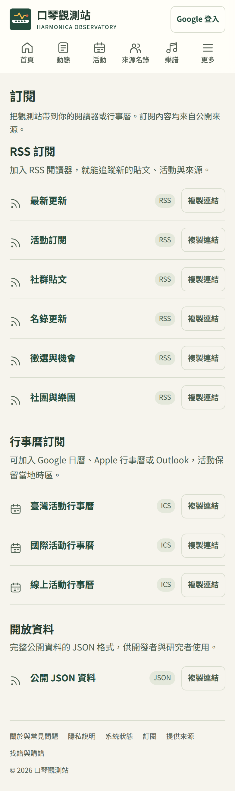
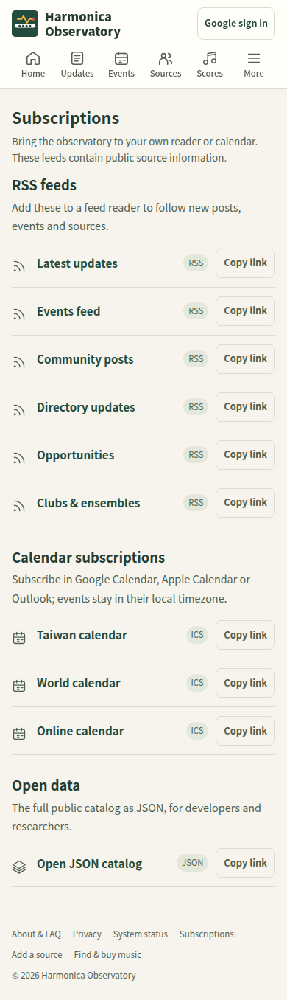
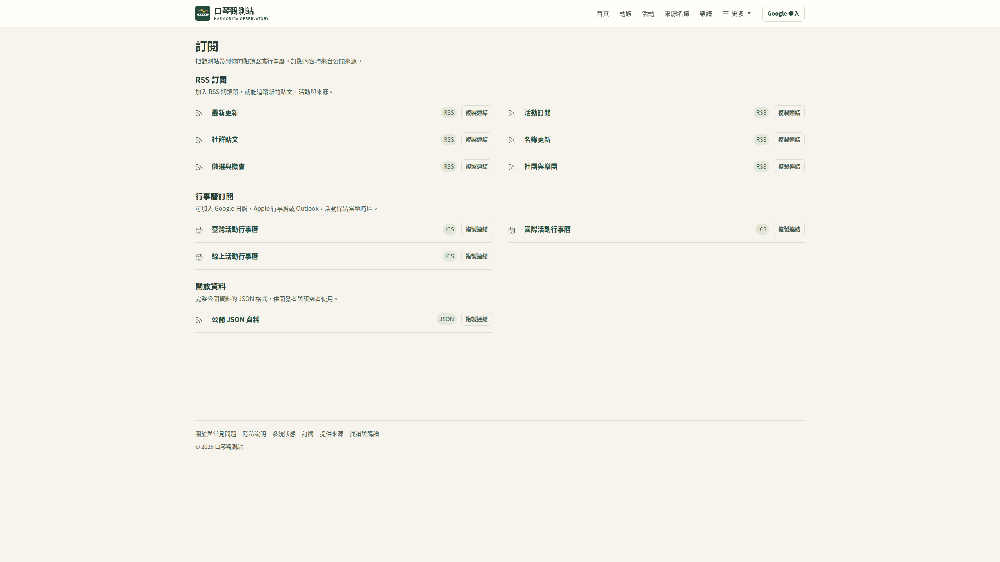
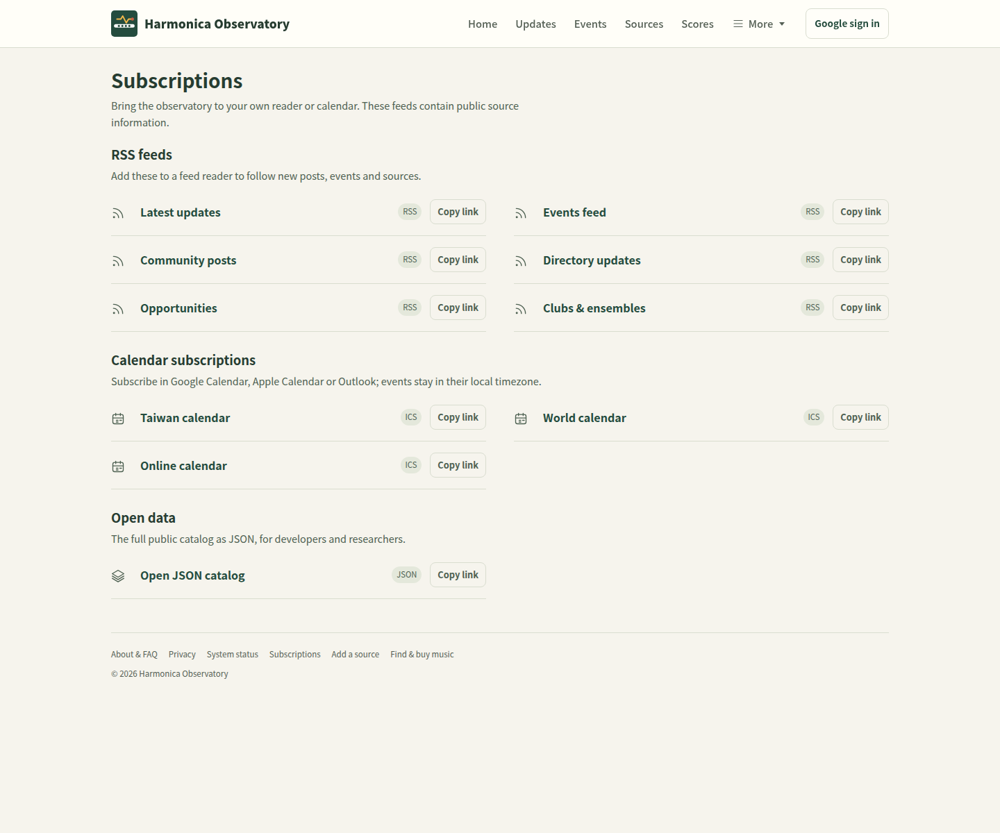

# v2 review results

Scores below are the arithmetic mean of the 12 saved category scores, not a new overall judge score. Opus partial results remain provisional.

| Round | Reviewer | Baseline mean | New mean | Reference mean | New − baseline |
|---|---|---:|---:|---:|---:|
| v2r1 | fable | 5.88 | 7.75 | 6.83 | +1.88 |
| v2r1 | gpt | 6.25 | 7.88 | 7.29 | +1.62 |
| v2r1 | opus | 4.92 | 7.42 | 7.33 | +2.50 |
| v2r2 | gpt | 6.12 | 8.04 | 7.42 | +1.92 |
| v2r2 | opus | 4.58 | 7.12 | 6.79 | +2.54 |
| v2r3 | gpt | 5.92 | 8.04 | 7.29 | +2.12 |
| v2r3 | opus (partial) | 5.50 | 7.42 | 7.21 | +1.92 |
| v2r4 | fable | 6.17 | 8.21 | 6.54 | +2.04 |
| v2r4 | gpt | 6.21 | 7.96 | 7.58 | +1.75 |
| v2r4 | opus | 5.38 | 7.83 | 7.08 | +2.46 |
| v2r5 | gpt | 6.21 | 8.17 | 7.50 | +1.96 |
| v2r5 | opus | 5.67 | 8.00 | 7.33 | +2.33 |
| v2r6 | gpt | 5.62 | 8.08 | 7.21 | +2.46 |
| v2r6 | opus (partial) | 5.54 | 8.08 | — | +2.54 |
| v2r7 | fable | 5.50 | 8.04 | 6.83 | +2.54 |
| v2r7 | gpt | 6.04 | 8.08 | 7.33 | +2.04 |
| v2r7 | opus (partial) | 5.08 | 7.33 | — | +2.25 |

v2r8: targeted final verification only; no new independent score was obtained. The saved v2r7 judgments did not meet the ≥9 stopping target.

The same baseline/reference ratings vary across rounds, indicating judge drift; small candidate-score changes should not be treated as measured improvement. R7 Opus saw 29 images per site group and no reference images.

Final check: JSON uses the existing layers icon; RSS and ICS keep their own icons. Two Chromium captures at 1440 px and 390 px were inspected. The saved before images use Traditional Chinese and the final images English, so they demonstrate layout and icon changes rather than a controlled language-matched comparison.

The redesign is now the only supported product interface and is enabled by default. The historical original interface remains available only through Git history and the deployment rollback tag.

Prior branch changes include localized 404 HTML presentation in `scripts/serve.py` and `scripts/render_shell.py`; this final verification made no backend changes. No production service was deployed or restarted.

